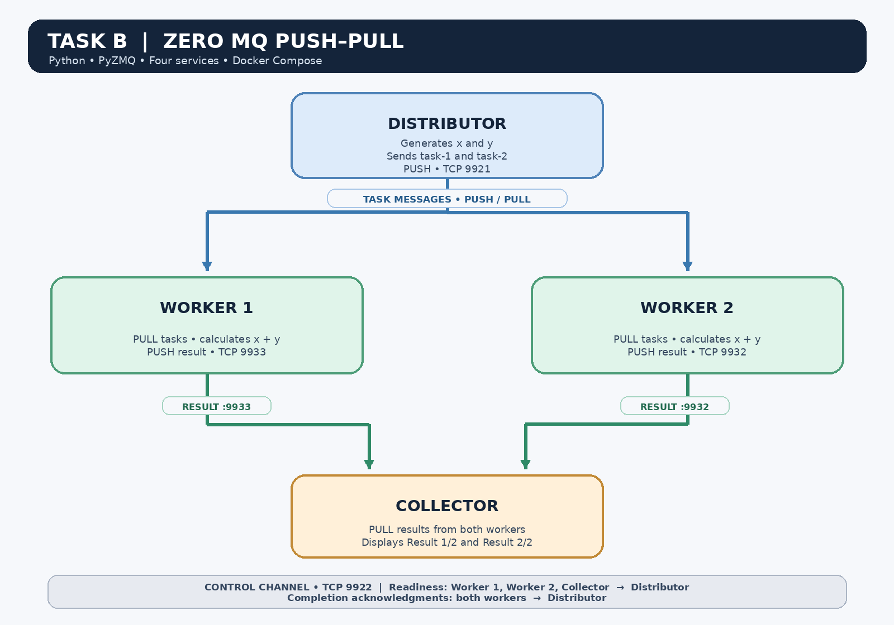

# Assignment 4 — Task B: ZeroMQ Push–Pull Pattern

**Student:** `[Your name]`  
**Student ID:** `[Your student ID]`  
**Course:** Distributed & Cloud Computing

## 1. Objective

This implementation demonstrates a Push–Pull communication pattern using Python ZeroMQ (PyZMQ). The system consists of one task distributor, two workers, and one task collector. The distributor generates two random integers, `x` and `y`, and sends two task messages. Each worker receives one task, calculates the sum, and sends a result message to the collector.

The implementation also uses readiness signals and worker-completion acknowledgments to make the startup and shutdown flow more reliable.

## 2. System illustration



### Explanation of the illustration

1. **Distributor:** creates two random integers and sends two separate task messages through a ZeroMQ `PUSH` socket on TCP port `9921`.
2. **Workers:** Worker 1 and Worker 2 each use a `PULL` socket to receive tasks. Each worker calculates `x + y`, creates a result message, and sends it through its own `PUSH` socket.
3. **Collector:** uses a `PULL` socket connected to both workers. It receives two result messages and prints the worker name, task ID, input values, and calculated sum.
4. **Readiness channel:** the workers and collector send readiness messages to the distributor through TCP port `9922`. Each worker waits for its task-receiving connection's ZeroMQ handshake to succeed before declaring itself ready. The distributor sends tasks after it has received readiness messages from all three participants.
5. **Completion acknowledgments:** after a worker has sent its result message, it sends `DONE|Worker 1` or `DONE|Worker 2` to the distributor on port `9922`. The distributor waits for acknowledgments from both workers before printing that it has finished.
6. **Resource cleanup:** each process closes its sockets and terminates its ZeroMQ context after completing its work.

The solid paths in the illustration represent task and result messages. The control-channel note describes readiness and completion messages that travel separately from the main task/result path.

## 3. Push–Pull communication pattern

The distributor-to-worker connection is a **load-balancing pattern**, not a broadcast pattern. The distributor sends two task messages, and ZeroMQ distributes messages among connected `PULL` workers. A message is not automatically copied to every worker. In the successful run recorded for this project, Worker 1 processed `task-1` and Worker 2 processed `task-2`.

The result path uses another Push–Pull connection: each worker pushes its result, and the collector pulls results from both worker endpoints.

## 4. Message serialization

The file `messages.py` defines two data classes:

- `TaskMessage` stores the task ID, the two input numbers, and the operation (`sum`).
- `ResultMessage` stores the task ID, worker ID, input numbers, and calculated result.

Before sending a message, a process uses `pickle.dumps()` to serialize the Python object into bytes. The receiving process uses `pickle.loads()` to reconstruct the object. This lets the components exchange structured Python messages over ZeroMQ sockets.

> `pickle` is appropriate here because the program exchanges messages within this controlled demonstration. It should not be used to deserialize arbitrary data from untrusted senders.

## 5. Network endpoints

| Communication | Socket pattern | Endpoint |
|---|---|---|
| Distributor → workers | `PUSH` → `PULL` | `tcp://distributor:9921` in Docker |
| Workers/collector → distributor (readiness and completion) | `PUSH` → `PULL` | `tcp://distributor:9922` in Docker |
| Worker 1 → collector | `PUSH` → `PULL` | Worker 1 binds port `9933` |
| Worker 2 → collector | `PUSH` → `PULL` | Worker 2 binds port `9932` |

Inside Docker Compose, containers use the service names (`distributor`, `worker1`, and `worker2`) as hostnames. When running locally, the default host is `127.0.0.1`.

## 6. Successful test result

The application was rebuilt and run with Docker Compose. The observed run generated `x = 23` and `y = 99`, so the expected sum was `122`.

The logs showed the following outcomes:

- The distributor sent `task-1` and `task-2`.
- Worker 1 received `task-1` and calculated `23 + 99 = 122`.
- Worker 2 received `task-2` and calculated `23 + 99 = 122`.
- The collector displayed both results and printed `All results received.`
- The distributor received completion acknowledgments from both workers and printed `Finished successfully.`

The numbers are random and may differ on another run. The key validation is that both workers process a task and the collector receives two results.

## 7. Screenshot evidence

**Replace the placeholders below with screenshots from your own Docker Desktop or terminal run before submitting.** Do not submit this report with the placeholders still present.

### Figure 1 — Distributor sends tasks

*Insert a screenshot showing the distributor's generated `x` and `y`, both sent tasks, and completion acknowledgments from Worker 1 and Worker 2.*

<!-- Suggested image after taking the screenshot:  -->

### Figure 2 — Worker 1 receives a task

*Insert a screenshot showing Worker 1 receiving its task, calculating the sum, sending the result, and sending its completion acknowledgment.*

<!-- Suggested image after taking the screenshot:  -->

### Figure 3 — Worker 2 receives a task

*Insert a screenshot showing Worker 2 receiving its task, calculating the sum, sending the result, and sending its completion acknowledgment.*

<!-- Suggested image after taking the screenshot:  -->

### Figure 4 — Collector receives results

*Insert a screenshot showing the collector displaying `Result 1/2`, `Result 2/2`, and `All results received.`*

<!-- Suggested image after taking the screenshot:  -->

## 8. How to run the application

### Run with Docker Compose

Run these commands from the project directory:

```powershell
docker compose config
docker compose up --build -d
docker compose logs --no-color
```

To inspect each service individually:

```powershell
docker compose logs distributor
docker compose logs worker1
docker compose logs worker2
docker compose logs collector
```

The programs finish automatically after processing the two tasks and collecting the two results. It is therefore normal for their containers to show an `Exited` status after a successful run; their logs remain available for inspection.

Stop and remove the Compose containers and network with:

```powershell
docker compose down
```

### Environment and container files

- `environment.yml` specifies a Conda environment using Python 3.11 and PyZMQ 27.2.0.
- `requirements.txt` pins the PyZMQ version used by Docker and the local virtual environment.
- `Dockerfile` creates the Python image, installs PyZMQ, and copies the four Python source files.
- `docker-compose.yml` defines the distributor, two workers, and collector as separate services.
- `.dockerignore` excludes the local virtual environment and Python cache files from the Docker build context.

## 9. Conclusion

This project demonstrates a ZeroMQ Push–Pull pattern with a task distributor, two workers, and a collector. It uses Python data classes and `pickle` serialization to exchange structured task and result messages. The readiness handshake prevents the distributor from sending work before all expected participants announce readiness, while worker-completion acknowledgments allow the distributor to wait for both workers before finishing. The successful Docker Compose test confirmed that both workers processed tasks and that the collector displayed both results.
